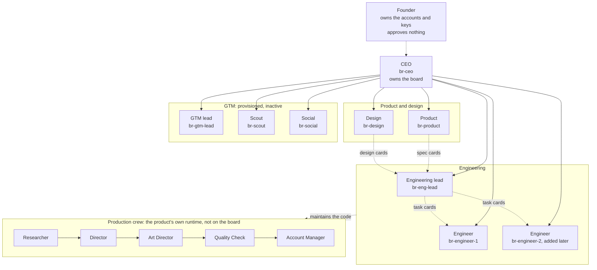

# The Boiler Room company

Boiler Room turns any website into a launch film. This folder is the spec for the company around
that product: who the agents are, what each one may touch, how work moves between them, and what a
person still has to do. Everything runs on Naive (`@usenaive-sdk/managed-agents`).

Status words used below: **verified** means a probe ran it on 2026-11-07 and the ids are quoted;
**docs** means the Naive docs say so and nobody ran it; **planned** means it is designed, not built.

## 1. Org chart

Solid lines are reporting lines: every agent reports to the CEO, because every card they finish
reaches the CEO automatically. Dotted lines are hand-overs by board card. The production crew makes
the films for customers. It is code in this repo, under `agents/`, and engineering maintains it like
any other part of the product. It is not part of the company's chain of command.

| Role                    | Agent                                  | Model                         | Started by                            | Detail                                               |
| ----------------------- | -------------------------------------- | ----------------------------- | ------------------------------------- | ---------------------------------------------------- |
| CEO                     | `br-ceo`                               | `anthropic/claude-sonnet-5.5` | Cron every 2 hours, and board digests | [roles/ceo.md](roles/ceo.md)                         |
| Engineering lead        | `br-eng-lead`                          | `anthropic/claude-sonnet-5.5` | Board card                            | [roles/engineering.md](roles/engineering.md)         |
| Engineer (1, later 2)   | `br-engineer-1`                        | `anthropic/claude-sonnet-5.5` | Board card                            | [roles/engineering.md](roles/engineering.md)         |
| Product                 | `br-product`                           | `anthropic/claude-sonnet-5.5` | Board card                            | [roles/product-design.md](roles/product-design.md)   |
| Design                  | `br-design`                            | `anthropic/claude-sonnet-5.5` | Board card                            | [roles/product-design.md](roles/product-design.md)   |
| GTM lead, Scout, Social | `br-gtm-lead`, `br-scout`, `br-social` | Sonnet, Haiku, Haiku          | Nothing until activated               | [roles/gtm.md](roles/gtm.md)                         |
| Production crew         | five agents                            | Haiku to Opus                 | The film pipeline                     | [roles/production-crew.md](roles/production-crew.md) |

## 2. How the hierarchy works on Naive

**The constraint.** A Naive team is one level deep. Putting a coordinator inside another
coordinator's roster is refused at save: `a team is one level deep`. A member cannot start
teammates and wait for them: `a teammate cannot start teammates of its own`. A roster holds up to 20
agents, and 4 delegated teammates run at once. Typed answers from delegated teammates did not work in
three attempts. So a CEO cannot sit over a head of engineering who runs engineers by delegation.

**The shape we chose: one board, one coordinator, leads that lead by card.** `br-ceo` is the only
coordinator. It has `board: true` and every company agent on its roster. Nobody delegates.
Leads create cards, assign them to members and order them with `blocked_by`. Probes
showed that this gives a real second tier: the engineering lead runs the engineers, and the CEO
still sees everything.

| What the design needs                                    | Result                                                                                                                                                                                                                                                                                                                                                                     | Evidence                                                                                                                                                                                       |
| -------------------------------------------------------- | -------------------------------------------------------------------------------------------------------------------------------------------------------------------------------------------------------------------------------------------------------------------------------------------------------------------------------------------------------------------------- | ---------------------------------------------------------------------------------------------------------------------------------------------------------------------------------------------- |
| A lead, not the coordinator, can create and assign cards | **Verified.** The lead created a card, assigned it to the engineer, and created a second card with an assignee and `blocked_by` in one call. Nothing was refused.                                                                                                                                                                                                          | Lead session `ses_sr1rnrdrgnj1m0egcezm5jtj8s`; cards `crd_7hxaxrgyhdksyw4vg7cx6q4svr`, `crd_2hbyzf59xrqe7k7nk8z3h3j920`                                                                        |
| Assigning a card starts the assignee                     | **Verified.** A top-level session of the assignee starts 3.6 s after the write (4.2 s for the CEO's card), with `metadata.board` naming the card.                                                                                                                                                                                                                          | Engineer session `ses_kc5a3r4pjsxqnqas0d1tjv9813`                                                                                                                                              |
| `blocked_by` holds work back until the blocker is done   | **Verified.** A blocked card stayed unwoken for 80 s. When its blocker was done, it went back to `todo` and its assignee started in under 1 s.                                                                                                                                                                                                                             | Cards `crd_svstxa1sn7vbqgjck3y0ha7y4f`, `crd_9j3ez2qj08av83zxmffrmd8f5a`; session `ses_q7fzdgt6h9zfm7ezd3w1x79bqv`                                                                             |
| Every team reports to the CEO, with no polling           | **Verified for `done` cards.** When cards reach `done`, the board starts a digest session of its owner, the CEO, 42 to 65 s later. Members' comments carry their session ids. **Docs only** for a card a member moves to `blocked`, and for a card the board parks. A card that sat `blocked` on an open blocker for 82 s, longer than one board tick, was never digested. | CEO digests `ses_wzvb5a2ej6tz6pcr66rhm9s2bg`, `ses_dm03t1xfj0f0vsn27mqsj3tkwg`, `ses_daqsfq4evv594ykfs2zwpc8md3`, each listing only `done` cards. Undigested: `crd_9j3ez2qj08av83zxmffrmd8f5a` |
| The CEO can read every card and comment                  | **Verified.** A typed read returned all 5 cards with comment counts matching the REST API.                                                                                                                                                                                                                                                                                 | `ses_e3yppp6551tc8t64k31253bd61`                                                                                                                                                               |
| The CEO can run on a clock                               | **Verified** for a CEO that is not a coordinator: a cron deployment fired on time as `system/cron` and read both boards. **Not run** for a coordinator CEO.                                                                                                                                                                                                                | Fire `ses_71049cm5gbhbwj9bjajrac7wc6`                                                                                                                                                          |

The whole flat-roster probe was 9 sessions for $0.013, on `anthropic/claude-haiku-5.5`. No computer
was provisioned, because the agents had no sandbox tools.

**The shape we rejected: a coordinator per department, and a CEO over them through Naive's MCP
server.** It also works: the CEO read and created cards on both department boards. But:

- It works only through the platform's org-wide CEO binding. Only one agent per org can hold it,
  only an admin can change that agent, and the binding clears only when the agent is deleted.
- Digests go to each department's coordinator, not to the CEO. A lead's report to the CEO by
  handoff was refused three times, and went through only with `handoffs: true`.
- The bound CEO is offered about 100 control-plane tools. Any tool not named in its policy parks
  the session on a human approval, which stalls an unattended CEO. All 93 unwanted tools had to be
  named and denied.
- We need neither of the things it adds: `wait: true` delegation inside a department, or more than
  20 seats.

**Limits the operating loop is built around** (docs, not observed):

- One card in flight per assignee per board. A second card for a busy agent waits its turn, so
  engineering runs in parallel only as many cards as it has engineer agents.
- Three wakes per card. A card whose session ends without moving it is parked as `blocked`, and
  that reaches the CEO as a digest. It is never retried in a loop.
- A session that hits its budget is not ended, so its card is neither parked nor digested. It
  pauses (`budget_paused`) and its card stays in `doing`, which also holds back that agent's next
  card. Raising the agent's ceiling resumes it, but only within 7 days. Only the CEO's sweep
  (section 4) catches this.
- A card-started session runs on the agent's `max_task_micro_usd`. Its budget cannot be set per
  card (verified: woken sessions showed the agent's ceiling).
- Card ids derive from the board, the writing session and the title, so a retried write with the
  same title is a no-op. That is why titles follow a fixed pattern (section 4).

## 3. Roles

Each role file gives the purpose, model, trigger, every tool and its access, what the role may not
do, its budget, and what it reports to whom.

- [CEO](roles/ceo.md)
- [Engineering lead and engineers](roles/engineering.md)
- [Product and design](roles/product-design.md)
- [GTM: GTM lead, Scout, Social and the inbox reader](roles/gtm.md)
- [Production crew: Researcher, Director, Art Director, Quality Check, Account Manager](roles/production-crew.md)

Every company agent starts from the same base policy, and each role adds only what it needs:

| Base setting                                      | Value                                                                                                                                                                                       | Why                                                                                                        |
| ------------------------------------------------- | ------------------------------------------------------------------------------------------------------------------------------------------------------------------------------------------- | ---------------------------------------------------------------------------------------------------------- |
| Harness                                           | `pi`                                                                                                                                                                                        | The only runnable harness that supports structured output. `claude_code` is not runnable.                  |
| Default permission                                | `deny`                                                                                                                                                                                      | Nothing is offered unless named                                                                            |
| `board_read`, `board_write`                       | allow                                                                                                                                                                                       | All work moves by card                                                                                     |
| `submit_output`, `session_spend`                  | allow                                                                                                                                                                                       |                                                                                                            |
| `send_to_agent`, `wait_for_agents`, `list_agents` | off                                                                                                                                                                                         | Members cannot wait on teammates, and the CEO must not park on one                                         |
| `ask_operator`, `request_tools`, `propose_plan`   | off                                                                                                                                                                                         | An unattended agent must not stop on a question. It moves its card to `blocked` instead.                   |
| `vetta.tools_search`, `vetta.tools_execute`       | off                                                                                                                                                                                         | They are offered even under `deny` unless named off (verified)                                             |
| `apps`, and every app's own tools (`br-app.*`)    | `apps` off unless the role turns it on. Every agent gets an explicit `allowed_apps`. Every app tool in the org is named on every agent: allow where the role lists it, off everywhere else. | Without `allowed_apps`, an agent is offered the tools of every app in the org (docs), even with `apps` off |
| `handoffs`                                        | `false`                                                                                                                                                                                     | Reports travel by card digest, not by handoff                                                              |
| Identity, vault credentials, MCP servers          | none                                                                                                                                                                                        | Added per role, only where stated                                                                          |

"Off" means `{ enabled: false, permission: "deny" }`. "Allow" means `{ enabled: true, permission: "allow" }`.

## 4. The operating loop

A **slug** names one piece of work from start to finish, for example `check-script`. Card titles use
a fixed prefix and the slug, so the board reads as a log and a retried write cannot duplicate a card.

| Step               | Who is started, and by what                                                              | What they read                                                                                        | What they produce                                                                                                                                                                                                                                                                                                                                                                                                            | What hands it on                                                                                                                      |
| ------------------ | ---------------------------------------------------------------------------------------- | ----------------------------------------------------------------------------------------------------- | ---------------------------------------------------------------------------------------------------------------------------------------------------------------------------------------------------------------------------------------------------------------------------------------------------------------------------------------------------------------------------------------------------------------------------- | ------------------------------------------------------------------------------------------------------------------------------------- |
| 1. Set direction   | `br-ceo`, by its cron fire. The fire opens the standing card `Recurring: Company sweep`. | The board, the founder's priorities in its system prompt, and the app's metrics once that tool exists | Card **`DIR: <slug>`** assigned to `br-product`. Body: goal, why now, done-when, budget, deadline, constraints.                                                                                                                                                                                                                                                                                                              | The assignment starts `br-product`                                                                                                    |
| 2. Spec            | `br-product`, by the `DIR` card                                                          | The `DIR` card, both repos, and feedback summaries                                                    | File **`specs/<slug>.md`** in `boiler-room-design`, on branch `spec/<slug>`, with a pull request into `dev`. If there is UI work, card **`DESIGN: <slug>`** assigned to `br-design`, then card **`BUILD: <slug>`** assigned to `br-eng-lead`, `blocked_by` the `DESIGN` card. With no UI, product merges the spec PR first, then creates `BUILD` citing the merge commit, because assigning `BUILD` starts the lead at once. | `DIR` moves to `done` with the PR link. The CEO gets a digest.                                                                        |
| 3. Design          | `br-design`, by the `DESIGN` card                                                        | The spec, and screenshots of the staging app                                                          | Files **`design/<slug>/`** (screens, states, copy, tokens) pushed to the same `spec/<slug>` branch. Then it merges the spec PR into `dev`.                                                                                                                                                                                                                                                                                   | `DESIGN` moves to `done`. That clears `BUILD` and starts the lead.                                                                    |
| 4. Plan the build  | `br-eng-lead`, by the `BUILD` card                                                       | `specs/<slug>.md` and `design/<slug>/` on `boiler-room-design` `dev`, at a named commit               | Cards **`ENG: <slug> <n>/<total> <task>`** assigned to engineers, ordered with `blocked_by`. Card **`SHIP: <slug>`** assigned to itself, `blocked_by` every `ENG` card.                                                                                                                                                                                                                                                      | `BUILD` moves to `done` with the plan. The assignments start the engineers.                                                           |
| 5. Build           | `br-engineer-1`, by an `ENG` card                                                        | The card, the spec, and the code                                                                      | Branch **`feat/<slug>-<n>`** and a **pull request into `dev`**. Commits carry `Board-Card:` and `Naive-Session:` trailers. `pnpm test`, `pnpm typecheck` and `pnpm lint` must pass.                                                                                                                                                                                                                                          | `ENG` moves to `done` with the PR URL and the test summary. When the last one is done, `SHIP` starts the lead.                        |
| 6. Review and ship | `br-eng-lead`, by the `SHIP` card                                                        | Each PR's diff, against the card's acceptance criteria and the rules in `CLAUDE.md`                   | PRs **merged into `dev`**, a **staging deploy** of the Naive app, and a smoke check                                                                                                                                                                                                                                                                                                                                          | `SHIP` moves to `done` with the merged PRs, the `dev` commit, the deployment id and URL, and the smoke result. The CEO gets a digest. |
| 7. Close the loop  | `br-ceo`, by the digest                                                                  | The `SHIP` note, against the `DIR` card's done-when                                                   | A comment on `DIR: <slug>`: delivered, or not. If not, a new `DIR` card next sweep.                                                                                                                                                                                                                                                                                                                                          | The next sweep's report                                                                                                               |
| 8. Promote         | `br-eng-lead`, by a `RELEASE` card the CEO creates when a `DIR` slug is delivered        | The CEO's report and the `SHIP` notes                                                                 | A PR from `dev` into `main`, merged by the lead, and the production deploy                                                                                                                                                                                                                                                                                                                                                   | `RELEASE` moves to `done` with the `main` commit and the production URL. The CEO gets a digest.                                       |

**When a step fails.** A failing member moves its card to `blocked` with the reason. A run that
stops without moving its card is parked as `blocked` by the board. The docs say either way the CEO
gets a digest, but only `done` digests have been seen (section 2). Until phase 1's probe shows a
`blocked` digest, the CEO's 2-hourly sweep, which opens every `blocked` card, is the backstop. The
CEO then reassigns the card, comments an answer, or escalates.

A run that hits its budget is not parked at all: its card stays in `doing`. The sweep lists every
`doing` card that has not moved for 2 hours, with its `woken_session_id`, on a `FOUNDER:` card,
because only the founder can see that session's status or raise the budget. Members check
`session_spend` before each long step and block the card at two thirds of their ceiling. That
reading lags the running turn (verified), so it is approximate.

A lead that rejects a PR creates a new `ENG: <slug> fix <n>` card and a new `SHIP: <slug> r2` card
blocked by it, because a card's `blocked_by` is fixed once the card is created.

**Escalating to the founder.** The company decides for itself. The CEO escalates only what a
person must physically do, such as creating an account, clicking an OAuth link, topping up credit or
raising an agent budget. It creates `FOUNDER: <need>`, leaves it `blocked` with no blocker, and lists
it at the top of its sweep report.

**What the CEO does with a digest.** It reads each card and acts only on what is blocked, or on what
a note asks for. A finished card is a report, not a cue to make more work. This is the board's own
rule, and it keeps the CEO from inventing work.

## 5. Credentials

| Tool                                                   | Used by                                                                                                | Held as                                                                                                                                                                                                                                                        | Status                                                                                                                        | Founder action                                                      |
| ------------------------------------------------------ | ------------------------------------------------------------------------------------------------------ | -------------------------------------------------------------------------------------------------------------------------------------------------------------------------------------------------------------------------------------------------------------- | ----------------------------------------------------------------------------------------------------------------------------- | ------------------------------------------------------------------- |
| Naive API key                                          | The provisioning script only                                                                           | `/home/moss/.boiler-room.env`                                                                                                                                                                                                                                  | **Have it**                                                                                                                   | None. It never goes into a sandbox, card, prompt or repo.           |
| Naive board, models, computers, image generation, Data | All agents                                                                                             | Built in                                                                                                                                                                                                                                                       | **Have it**                                                                                                                   | None                                                                |
| Naive app hosting and Postgres                         | `br-eng-lead`                                                                                          | The `apps` tool, limited by `allowed_apps` to the staging app. `DATABASE_URL` and its siblings are injected by the platform.                                                                                                                                   | **Self-served**                                                                                                               | None                                                                |
| Clerk                                                  | The app's server code. Engineers write the code, never hold the keys.                                  | Naive app secrets, set by the provisioning script                                                                                                                                                                                                              | **Have it.** `CLERK_SECRET_KEY` and `NEXT_PUBLIC_CLERK_PUBLISHABLE_KEY` are in the env file now, from a development instance. | Later: a Clerk production instance, which needs a custom domain (A) |
| GitHub write to `boiler-room`                          | `br-eng-lead`, engineers                                                                               | A fine-grained token in `~/.netrc` on each agent's computer                                                                                                                                                                                                    | **Needed**                                                                                                                    | Create it (B)                                                       |
| GitHub write to `boiler-room-design`                   | `br-product`, `br-design`                                                                              | A second fine-grained token, the same way                                                                                                                                                                                                                      | **Needed** before phase 3                                                                                                     | Create it (B)                                                       |
| Branch rules on `main` and `dev`                       | Everyone                                                                                               | GitHub repository settings                                                                                                                                                                                                                                     | **Needed**                                                                                                                    | Add them (C)                                                        |
| AgentMail (`boilerroom@agentmail.to`)                  | The app's server code, and `br-inbox-reader`                                                           | App secret, plus one vault credential bound to the reader                                                                                                                                                                                                      | **Have it** (`AGENTMAIL_API_KEY`)                                                                                             | Later: change the sender name to Boiler Room                        |
| Naive Social                                           | `br-social`                                                                                            | The GTM persona's social workspace                                                                                                                                                                                                                             | **Needed** at GTM activation                                                                                                  | Connect the networks (D)                                            |
| Scoped Naive key for the app                           | The app's server code, to start a `br-inbox-reader` session for each inbound email and read its output | App secret. Scopes `sessions:write` and `sessions:read` only. Not `agents:write`: that scope also manages agents, app secrets and app deployments, and deletes apps (docs). So the app creates no cards; the GTM lead does (see [roles/gtm.md](roles/gtm.md)). | **Self-served**: minted by the provisioning script with the admin key. Not yet minted or tested.                              | None                                                                |

**A. Clerk production instance (later).** In the Clerk dashboard, create the production instance,
and add the custom domain that the Naive app will use (a `*.vercel.app` address is not accepted).
Then put the production keys into the env file under the same two names. Until then the development
instance works, but it caps sign-ups at 100 users and shows a Development banner.

**B. Two fine-grained GitHub tokens.**

1. Sign in to GitHub as `latchkey-ops-bot`, which owns both repos.
2. Go to Settings, Developer settings, Personal access tokens, Fine-grained tokens, and choose
   Generate new token.
3. Name `br-engineering`. Expiration 30 days. Resource owner `latchkey-ops-bot`. Repository access:
   Only select repositories, then `boiler-room`. Permissions: Contents read and write, Pull requests
   read and write. Metadata read is added for you.
4. Generate it. Add it to `/home/moss/.boiler-room.env` as `BR_GITHUB_TOKEN_ENG=`. Do not paste it
   into a chat.
5. Repeat with name `br-design`, repository `boiler-room-design`, and the variable
   `BR_GITHUB_TOKEN_DESIGN`.

The provisioning script writes each token into `~/.netrc` on the agents' computers with Naive's
file write (`computers.fs`). Then it runs `chmod 600` with a command that holds only the path. It
never puts the token in a shell command, because Naive keeps shell command text for 30 days without
redaction. The file write, owner and mode were verified with a throwaway key. Git and
`curl --netrc` should then read the token from the file, so it never appears in a command. That
last part is untested. Deploy keys are not needed. The two keypairs generated earlier sit in a
temporary folder and will be lost. That is fine.

**C. Branch rules.** In each repo, go to Settings, Rules, Rulesets, New branch ruleset.

- `protect-main`: target `main`. Turn on Restrict deletions, Block force pushes, and Require a pull
  request before merging, with 0 required approvals. Leave the bypass list empty. Agents merge their
  own PRs, so every change to `main` still leaves a PR record. How these rules treat the agents'
  tokens has not been tested.
- `protect-dev`: target `dev`. The same rules, with 0 required approvals. Agents can still merge
  PRs into `dev`, but nothing can push to it directly.

**D. Social networks (at GTM activation).** The provisioning script activates Naive Social for the
GTM persona and returns a portal link. Open it once and sign in to each network you want, such as
X, LinkedIn, Bluesky and Threads. No agent can do this step.

## 6. Guard rails

**Budgets.** Every agent has a daily cap and a per-task ceiling. Naive prices every call before it
runs and refuses one that would break either. Every session carries a budget. Card-started sessions
use the agent's ceiling.

| Team               | Agents                                                    | Daily cap                    | Per-task ceiling               |
| ------------------ | --------------------------------------------------------- | ---------------------------- | ------------------------------ |
| CEO                | `br-ceo`                                                  | $5                           | $1.00, and $1.00 per cron fire |
| Engineering        | `br-eng-lead`, `br-engineer-1`                            | $10 each                     | $1.50                          |
| Product and design | `br-product`, `br-design`                                 | $4, $5                       | $1.00                          |
| GTM, inactive      | `br-gtm-lead`, `br-scout`, `br-social`, `br-inbox-reader` | $0                           | $0                             |
| Production crew    | five agents                                               | Set per film by the pipeline | Set per session                |

The ceilings for Sonnet agents are $1.00 or more because Naive refused a Sonnet engineering session
at $0.30 ("below the pre-flight quote") and accepted it at $1.00. That is one data point with one
toolset, so treat the floor as inferred. The real costs measured so far are much lower: a full
clone, install, test and commit run by an engineer cost $0.066 for the model and $0.006 for the
computer, and a CEO digest on Haiku cost $0.001 to $0.002. Media is billed after the call, so a
per-task ceiling does not bound an image render. Design is limited to 4 renders per card by its
prompt. A cap of $0 means the agent cannot spend anything (docs), which keeps GTM inactive.

**Least privilege.** Each team gets only its own tools and its own repo:

- Engineering writes `boiler-room` only. Product and design write `boiler-room-design` only. Each
  token reaches one repo.
- Only the engineering lead can deploy, and only to the staging app, through `allowed_apps`.
- Only GTM agents hold a social identity. Social, email and connection tools appear only in a
  session that selects that identity (verified).
- GTM agents have no `bash`, no file writes, no repo token, and the `apps` tool off. They still get
  the app's own tools (verified).
- No agent holds a key that can change agents, agent budgets, vault credentials or cron
  deployments. Only the provisioning script, which runs outside every agent, can. The app's own key is limited
  to sessions, but `sessions:write` can start any agent's session and raise any session's budget
  (docs), within each agent's daily cap. We accept that.
- Only `br-eng-lead` merges into `main` and deploys production, and only from a `RELEASE` card.
  Engineers cannot.

**Prompt injection.** Customer email, social content, lead data and customer websites are all
untrusted. Naive adds one guard by itself: after an agent calls any external MCP tool or connected
app, the rest of that chat cannot run `bash`, and every later call waits for a human (verified, even
for a harmless read). The design works with that guard rather than against it:

1. **Readers hold nothing worth stealing.** `br-inbox-reader` makes one AgentMail read, then returns
   fixed fields (sender, an intent from a fixed list, a summary of up to 280 characters) through
   `submit_output`. It has no `bash`, no send tools and no other credential. The Researcher reads
   customer websites with no credential on its computer, and the Validator rejects any claim that
   is not quoted word for word from a page.
2. **Sending is an app tool, not a raw API.** The app's server holds the AgentMail key. Its
   `send_email` tool sends only to addresses on an allowlist (approved leads, or people who wrote to
   us first), up to a daily quota, with no attachments, and only after AgentMail's flagged check
   passes. That logic is app code (planned).
3. **Raw email never reaches an agent that can act on it.** App tools do not set Naive's read flag
   (verified with a test tool). So the app never returns a raw email body, only the reader's fixed
   fields. The 280-character summary is still written by a model from an untrusted email, so it
   can carry an attacker's words to the GTM lead, which holds `send_email`. The real control is the
   app: its allowlist and daily quota on `send_email`.
4. **Every MCP tool and every app tool is named.** Under a deny default, unnamed MCP tools are
   still offered, at "ask" (verified), and an ask parks an unattended session. Every AgentMail tool
   is named, and all send, delete, create and connect tools are off for the reader. Every `br-app.*`
   tool is named on every agent (section 3), so adding a tool to the app's `/mcp` means re-running
   the provisioning script. How an unnamed app tool behaves under a deny default is untested.
5. **Builders never read raw untrusted content.** The CEO, engineering, product and design never
   read the inbox, social content or web search results. `web_search` is off for all of them: it
   returns untrusted pages, and the read flag, which covers contacts, mail, messages and connected
   apps, does not cover it (docs). Product and design do read the reader's summaries, which are
   derived from untrusted email (see Secrets). Both repos are public, so agents never act on
   issues, PR comments or PRs from outside accounts. The lead merges only branches named in an
   `ENG` card's note.

**Secrets.** Both repos are public. A secret goes in one of two places: the Naive vault (MCP
credentials, bound to one agent, never readable back) or Naive app secrets (server-side keys). It
never goes in a prompt, card, commit, command line or log. The GitHub tokens are the one exception.
The vault can only inject credentials for MCP connections (environment variable credentials return
501), so git cannot use it. Those tokens therefore live in a file on the agent's computer. The model
can read that file, and the shell can reach the internet. We accept that risk. It is bounded by one
repo per token, a 30-day expiry, and the branch rules. The lead also runs a secret-pattern check on
every diff before it merges. Product and design hold a token and open egress, and they read the
reader's summaries, so a crafted email could put up to 280 characters of instructions in front of
them. We accept that too, with the same bounds.

**Audit.** Every card keeps its brief, its holder's note, comments signed with session ids, the
session that was started on it, and how many times it was started. Commits carry `Board-Card:` and
`Naive-Session:` trailers, and PRs link their card. Naive keeps every session's events, the spend
ledger per agent and session, and an audit log. The CEO's sweep report lists what moved, what is
blocked, and every `FOUNDER:` card.

## 7. Build order

| Phase                            | What gets built                                                                                                                                                                                                                                                                                                                                                 | Done when                                                                                                                                                                                                                                                  |
| -------------------------------- | --------------------------------------------------------------------------------------------------------------------------------------------------------------------------------------------------------------------------------------------------------------------------------------------------------------------------------------------------------------- | ---------------------------------------------------------------------------------------------------------------------------------------------------------------------------------------------------------------------------------------------------------- |
| 1. CEO, board, production crew   | A provisioning script under `ops/company/`, which creates agents from code, writes tokens and sets app secrets. `br-ceo` as coordinator with `board: true` and `br-engineer-1` on its roster, because a roster needs 1 to 20 entries and an empty coordinator is not a team (docs). Its cron deployment. The production crew, Researcher first, from `agents/`. | A cron fire closes its standing card with a report. `br-engineer-1`, given a card before its token exists, moves it to `blocked` with `credential missing`, and the CEO receives a digest naming it. The Researcher returns a valid result for a real URL. |
| 2. One engineer, one real task   | The `br-engineering` token and the branch rules. The CEO assigns `ENG: check-script 1/1`: add a root `check` script that runs `pnpm lint`, `pnpm typecheck` and `pnpm test`, list it under Commands in `README.md`, and open a PR into `dev`. Then add `br-eng-lead` and the staging app.                                                                       | `br-engineer-1` opens that PR with nobody touching the run, and the checks pass. The next task goes through `SHIP` and lands on staging.                                                                                                                   |
| 3. Product and design            | The `br-design` token, `br-product` and `br-design`                                                                                                                                                                                                                                                                                                             | One `DIR` card goes through steps 1 to 7 with no human step.                                                                                                                                                                                               |
| 4. GTM, provisioned but inactive | `br-gtm-lead`, `br-scout`, `br-social` and `br-inbox-reader` at a $0 budget, plus the GTM persona. No cards, no cron.                                                                                                                                                                                                                                           | The agents exist and cannot spend. The founder decides when the product is nailed down. Activation is in [roles/gtm.md](roles/gtm.md).                                                                                                                     |

**Shipping to `main` is autonomous.** The founder has given the company full permission. Work lands
in `dev` and on staging first. When a `DIR` slug is delivered, the CEO creates a `RELEASE` card and
the engineering lead promotes `dev` to `main` and deploys production. No person approves it.

## 8. What is verified and what is not

**Verified by running, on 2026-11-07:**

- Teams are one level deep, and members cannot wait on teammates.
- A member creates and assigns cards. Assignment starts the assignee within about 4 s.
  `blocked_by` holds work and releases it in under 1 s. Done cards reach the board owner as
  digests.
- A cron deployment fires on schedule and runs with no person present, for a CEO that is not a
  coordinator.
- An engineer agent on Sonnet cloned the repo, installed it, ran 522 passing tests, branched and
  committed with trailers, in 133 s for $0.066. A 1 vCPU / 1 GiB computer was enough (peak 566 MB).
- Naive's file write places a key file on an agent's computer with the right owner and mode.
  Outbound SSH reaches GitHub.
- The vault refuses environment-variable and SSH credentials, and injects an MCP credential without
  the model seeing it (AgentMail listed the inbox).
- Any external MCP call sets the read flag. An app's own MCP tool did not, in a test that returned
  `pong`. Unnamed MCP tools are offered at "ask" under a deny default.
- A Naive app deploys from source in about 33 s. It gets Postgres 17 with the database variables
  injected. Clerk runs server-side on it with a development instance.
- Naive Social activates and returns a portal link. Naive Data and image generation run, and are
  priced per call.

**Not verified:**

- A **coordinator** CEO on a cron, and its `Recurring:` standing card.
- A digest of a card that a member moves to `blocked`, or that the board parks. Phase 1 probes the
  first. A card blocked on an open blocker was not digested.
- A card whose session hit its budget staying in `doing` (docs).
- Product or design creating cards for the lead. It is the same path as lead to engineer, but it
  was not run.
- The board flow on Sonnet agents (the probes used Haiku), and the pre-flight floor for each role.
- **A push or PR with a real credential.** No token or deploy key was ever registered, so every
  push was refused. Git and the REST API reading `~/.netrc` is untested.
- Whether the token file survives the agent's computer being replaced. The engineer's first step
  checks for it and blocks the card if it is missing.
- The agent-side `apps` deploy action. Only the REST route was run.
- Whether an app tool that returns email text sets the read flag.
- The AgentMail webhook to the app, the app starting a reader session with its scoped key, and the
  GTM lead creating cards from the summaries. The key's scopes come from the docs.
- How an unnamed app tool behaves under a deny default, and whether `allowed_apps: []` is accepted
  and hides app tools.
- Posting, scheduling and analytics on Naive Social, because no network was connected.
- Whether a card-started session selects the agent's persona. Social tools appear only in a session
  that selects it. If a card-started session does not, `br-social` must run from a deployment
  instead, because a deployment can name a persona.
- Clerk sign-in in a browser, and a Clerk production instance.
- A $0 agent parking a card that was assigned to it.
- Whether the limit of 4 concurrent teammates applies to card-started sessions.
- Whether Sonnet sets better direction than Haiku, or Opus better than Sonnet. Typed delegation
  did not work, so it is not used anywhere.
