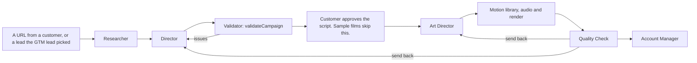

# Production crew: the product's own runtime

The production crew makes the films. It is the product, not part of the company's chain of command.
Its agents are defined in code under `agents/` in this repo. They are synced to Naive by a script and
run by the film pipeline. **Engineering maintains it** through the normal loop: a change to the crew
is a `DIR` card, then a spec, then `ENG` cards and a PR, like any other change.

The crew is not on `br-ceo`'s roster and not on any board. Each step runs as a top-level session
started by the pipeline, with an `output_schema`. That is the typed path that was verified: 11 of 11
top-level sessions returned valid structured output, while typed answers through delegation failed
three times. The pipeline checks each output in code before it starts the next step.

## Agents

| Agent | Purpose | Proposed model | Output it returns | Status |
| --- | --- | --- | --- | --- |
| Researcher | Captures the site with Playwright: screenshots, colours, fonts and logo. Extracts claims quoted word for word, with their source URL. | `anthropic/claude-haiku-5.5` | Research JSON | Building, on branch `feat/researcher-agent` |
| Director | Writes the script and scenes into `campaign.json`. Reworks what the Validator or Quality Check sends back. | `anthropic/claude-sonnet-5.5`, or Opus once benchmarked | `campaign.json` | Planned |
| Art Director | Picks scenes from the motion library, and generates missing assets with Naive | `anthropic/claude-sonnet-5.5` | Scene picks and asset ids | Planned |
| Quality Check | Inspects contact sheets, the frames around each transition, legibility at phone size, the brand, and the claims | `anthropic/claude-opus-5.5` | A review report: pass, or send back with reasons | Planned |
| Account Manager | Delivers the film by a Naive file link and an email, and handles revisions | `anthropic/claude-sonnet-5.5` | A delivery record | Planned |

The models follow the earlier probe's picks: Haiku for procedures, Opus for judgement. Those picks
were not benchmarked on real briefs.

## Tools and limits

- **Researcher.** `bash` and Playwright on its own computer, with the 2 GiB swap recipe, and
  `publish_file`. It holds no token and no send tool. Customer websites are untrusted. The worst a
  hostile page can do is waste its budget or poison its research JSON, and the Validator rejects
  any claim that is not quoted word for word from the page. One browser runs at a time per
  computer, so parallel sites need separate agents or a queue.
- **Director.** No tools beyond `submit_output`. It works from the research JSON it is given.
- **Art Director.** `generate_image` and the other generation tools, limited by a per-film media
  cap held in the pipeline. Media is billed after the call, so agent budgets do not cap it.
- **Quality Check.** `view_image` on rendered frames, and `submit_output`.
- **Account Manager.** The app's `send_email` tool, under the same allowlist and quota rules as GTM.
  It sees only the inbox reader's fixed fields, never raw email.

Every crew agent uses the [base policy](../README.md#3-roles) except the board tools, which it does
not have. Budgets are set per film by the pipeline, through each session's `budget_micro_usd`.

## Rules that come from the product

These are in `CLAUDE.md`, and the crew must follow them:

- Never invent product claims. Every number on screen or in voiceover must appear in the verbatim
  quote of a claim.
- Render only a campaign that `validateCampaign` passed.
- Sample films use another company's brand. They go only to that company, and are never posted.

## A caveat to keep

Naive seats every agent in the org on the **company board** once an agent is bound as the platform
CEO. This spec binds none. If anyone ever binds one, the crew agents would join that board and
receive board tools automatically.
