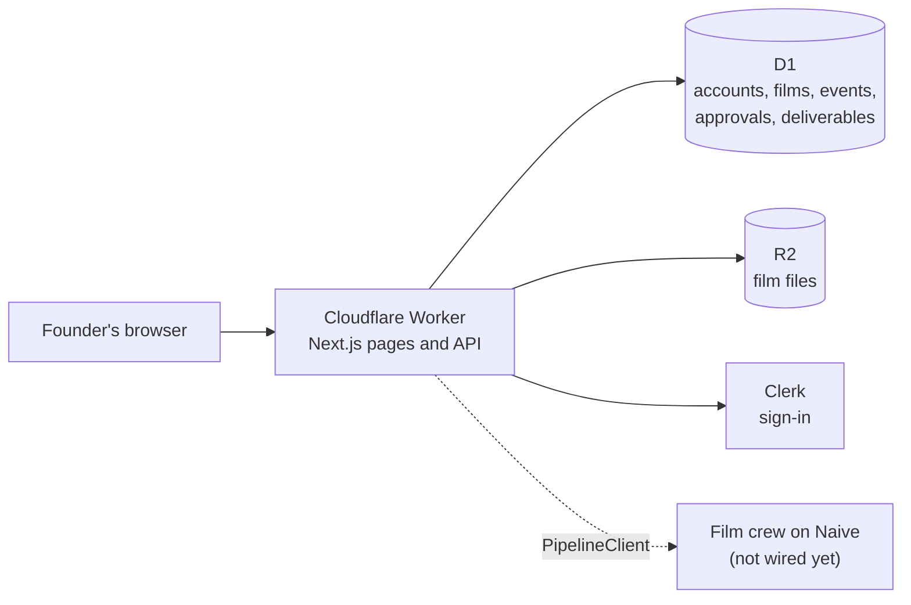

# Deploying the web app

The website and the app are one Next.js app in `apps/web`, running on Cloudflare. This page is for
people: what runs where, how to set it up, and how a change reaches customers. The engineering
agents follow the same procedures in
[`skills/engineering-deploy/SKILL.md`](../skills/engineering-deploy/SKILL.md).

## What runs where



| Environment | Worker                       | URL                                                      | D1                       | R2                             | Deploys                  | Who           |
| ----------- | ---------------------------- | -------------------------------------------------------- | ------------------------ | ------------------------------ | ------------------------ | ------------- |
| Local       | workerd on your computer     | `http://localhost:3000`, or `:8787` for the built Worker | `.wrangler/state`        | `.wrangler/state`              | Your working tree        | Anyone        |
| Staging     | `boiler-room-web-staging`    | https://boiler-room-web-staging.boilerroom.workers.dev   | `boiler-room-staging`    | `boiler-room-films-staging`    | The tip of `origin/dev`  | `br-eng-lead` |
| Production  | `boiler-room-web-production` | Not deployed yet                                         | `boiler-room-production` | `boiler-room-films-production` | The tip of `origin/main` | The founder   |

Staging makes simulated films: no crew runs, the script is a sample, and every screen says
"Simulated". Production never makes simulated films. Until the Naive pipeline is wired, starting a
film in production answers "The film crew is not connected yet".

## The stack, and why

| Piece                    | Version         | Notes                                                                                 |
| ------------------------ | --------------- | ------------------------------------------------------------------------------------- |
| Next.js, App Router      | 16.4.5          | The OpenNext adapter accepts Next `>=16.4.5` or the latest 15.5                       |
| OpenNext Cloudflare      | 1.20.16         | Builds Next into a Worker with static assets                                          |
| wrangler                 | 4.158.0         | In `apps/web`, not global. Every script runs it with `pnpm exec`                      |
| Clerk, `@clerk/nextjs`   | 7.9.25          | Runs in `src/middleware.ts` on the Edge runtime                                       |
| Drizzle ORM, drizzle-kit | 0.45.4, 0.31.11 | Schema and migrations for D1. drizzle-kit writes flat SQL files that wrangler applies |

One choice looks odd and is deliberate: the app uses `middleware.ts`, which Next 16 calls deprecated,
instead of `proxy.ts`. Next 16's `proxy.ts` always runs on the Node.js runtime, and the OpenNext
Cloudflare adapter supports only Edge middleware. The build prints a deprecation warning; ignore it
until the adapter supports Node middleware. This combination was built and run on workerd before
anything else was written: Clerk protected a page, an API route answered 401, and a route read D1.

## Credentials

Every script reads keys from `~/.boiler-room.env` at run time (or the file in `BR_ENV_FILE`). Values
go to wrangler through its environment or stdin, never on a command line, and are never printed.

| Name                                            | Used for                                                       |
| ----------------------------------------------- | -------------------------------------------------------------- |
| `CLOUDFLARE_API_TOKEN`, `CLOUDFLARE_ACCOUNT_ID` | Creating D1 and R2, migrating, deploying, secrets, logs        |
| `CLERK_SECRET_KEY`                              | Sign-in, on the server. Becomes a Worker secret                |
| `NEXT_PUBLIC_CLERK_PUBLISHABLE_KEY`             | Sign-in, in the browser. Inlined at build, and a Worker secret |

Any of them can be set per environment with a prefix: `STAGING_CLERK_SECRET_KEY` wins over
`CLERK_SECRET_KEY` for staging. Production reads only `PRODUCTION_CLERK_SECRET_KEY` and
`PRODUCTION_NEXT_PUBLIC_CLERK_PUBLISHABLE_KEY`, never the unscoped keys, and the build and secret
sync stop if either is a development key (`sk_test_` or `pk_test_`). Today staging uses Clerk's
development instance.

The token in the env file today could create the staging D1 database and R2 bucket, apply
migrations, set secrets, deploy, list versions and tail logs. A Cloudflare token reaches the whole
account, not one Worker, so it could deploy production too. What stops an agent is the production
guard: every production script waits for a person to type `production` at a terminal, and an agent
has no terminal.

**For the engineering lead's computer (founder action, not done yet):** the lead needs the same
file with `CLOUDFLARE_API_TOKEN`, `CLOUDFLARE_ACCOUNT_ID` and the two Clerk keys, written by the
provisioning script with mode 600, like the GitHub token in `~/.netrc`. Without it, the lead moves a
`SHIP` card to `blocked` with `credential missing`.

## Working on it locally

Requires Node 24 and pnpm 10.

```sh
pnpm install
pnpm web:dev          # http://localhost:3000, with local D1 and R2
pnpm web:preview      # builds the real Worker and runs it on workerd at http://localhost:8787
pnpm web:test         # unit tests: URL rule, pipeline, API on a real local D1
pnpm web:test:smoke   # Playwright against the built Worker (builds it first)
pnpm typecheck && pnpm lint
```

`pnpm web:dev` writes `apps/web/.dev.vars` (gitignored) with Clerk's keys from the env file, applies
the migrations to the local D1 in `apps/web/.wrangler/state`, and starts Next. Never put keys in a
`.env` file in `apps/web`: OpenNext bundles those into the Worker.

The smoke test needs a browser once: `pnpm --filter @boiler-room/web exec playwright install
chromium`.

## Every command

| Command                                | Does                                                                                                |
| -------------------------------------- | --------------------------------------------------------------------------------------------------- |
| `pnpm web:dev`                         | Local dev server                                                                                    |
| `pnpm web:preview`                     | The built Worker, locally                                                                           |
| `pnpm web:test`, `pnpm web:test:smoke` | Unit tests; Playwright smoke test (set `BASE_URL` to test a deployed environment)                   |
| `pnpm web:build`                       | Builds the Worker for local preview, or `pnpm web:build staging`                                    |
| `pnpm web:smoke <url>`                 | The smoke check against any URL                                                                     |
| `pnpm web:db:generate`                 | Writes the next migration from `src/db/schema.ts`                                                   |
| `pnpm web:db:migrate:local`            | Applies migrations to the local D1                                                                  |
| `pnpm web:db:migrate:<env>`            | Applies pending migrations to staging or production                                                 |
| `pnpm web:provision:<env>`             | Creates the environment's D1 and R2 if missing, and writes the D1 id into `wrangler.jsonc`          |
| `pnpm web:secrets:sync:<env>`          | Copies the Worker secrets from the env file to Cloudflare                                           |
| `pnpm web:deploy:<env>`                | Builds, deploys and smoke-checks. Refuses uncommitted code, the wrong commit, or pending migrations |
| `pnpm web:rollback:<env> [version-id]` | Lists recent versions and makes an earlier one live                                                 |
| `pnpm web:logs:<env> [tail flags]`     | Streams the live Worker's logs, for example `--status error`                                        |

`<env>` is `staging` or `production`. Every production command stops for you to type `production`.

## How a change reaches customers

1. **Build.** An engineer opens a pull request into `dev` (an `ENG` card).
2. **Staging.** The engineering lead merges it, migrates staging if the change has a migration, runs
   `pnpm web:deploy:staging`, and checks it (a `SHIP` card).
3. **Release.** Production is the founder's. A release promotes `dev`, already proven on staging,
   to `main` and to production (a `RELEASE` card, which the lead prepares and the founder runs):

   ```sh
   # 1. Open a pull request from dev into main, and merge it on GitHub.
   git fetch origin && git checkout --detach origin/main   # a clean tree
   pnpm install --frozen-lockfile
   pnpm web:db:migrate:production    # only if the release has migrations
   pnpm web:deploy:production        # builds, deploys, smoke-checks
   ```

A **bug fix** takes the same road: a `HOTFIX` card, a pull request into `dev` with a test that
failed before the fix, staging, then a release.

## First production release

Once, before the first `pnpm web:deploy:production`:

1. **Clerk production instance.** Create it in the Clerk dashboard. It needs a custom domain, so
   pick the domain for production first. Add its keys to the env file as
   `PRODUCTION_CLERK_SECRET_KEY` and `PRODUCTION_NEXT_PUBLIC_CLERK_PUBLISHABLE_KEY`.
2. **Domain.** Add the domain to Cloudflare and route it to `boiler-room-web-production` (a
   `routes` entry in `env.production` of `wrangler.jsonc`, by pull request).
3. `pnpm web:provision:production`, then commit the database id it writes into `wrangler.jsonc` by
   pull request into `dev`, and release it.
4. `pnpm web:secrets:sync:production`
5. `pnpm web:db:migrate:production`
6. `pnpm web:deploy:production`

## Rolling back

`pnpm web:rollback:staging` lists recent versions, each tagged with the commit it was built from,
and makes the one before the live one live again, in seconds. Pass a version id to pick another.
Then run `pnpm web:smoke <url>`: `/api/health` shows the older commit as `version`.

A rollback never touches D1. That is why every migration must work with the code before it.

## Database migrations

Change `apps/web/src/db/schema.ts`, run `pnpm web:db:generate`, read the SQL it writes, and commit it.
Migrations are applied **before** the code that needs them is deployed, and must keep the code
already running working: add columns as nullable or with a default; rename or drop only in a later
release, once nothing uses the old shape; never edit a migration that has run. The skill has the
details. D1 keeps 30 days of history (Time Travel) if a restore is ever needed.

## Logs and checks

`pnpm web:logs:staging` streams requests, `console` output and exceptions. Every 500 is logged as
`Unhandled API error` with its stack; the caller only sees "Something went wrong on our side".
Workers observability is on, so the Cloudflare dashboard keeps searchable logs.

After every deploy, the smoke check confirms: `/api/health` is 200 with D1 up and the deployed
commit as `version`; the landing page and showcase render; the API refuses a signed-out caller;
app pages send a signed-out visitor to sign in. On staging, also sign in and run a simulated video
from URL to "Delivered".

## Troubleshooting

| You see                                                    | It means                                                                                                         |
| ---------------------------------------------------------- | ---------------------------------------------------------------------------------------------------------------- |
| An HTML page from `/api/health` right after a first deploy | workers.dev has not reached every edge yet. The smoke check waits up to 30 seconds for it                        |
| `D1 has migrations to apply`                               | Run `pnpm web:db:migrate:<env>`, then deploy again                                                               |
| `HEAD is not origin/dev`                                   | Check out `origin/dev`. `--any-commit` deploys another commit to staging for a test                              |
| `env.<env> has no D1 database yet`                         | Run `pnpm web:provision:<env>` and commit the id it writes                                                       |
| `The "middleware" file convention is deprecated`           | Expected. See "The stack, and why"                                                                               |
| A build that never ends                                    | `apps/web`'s `build` script must stay `next build`. OpenNext runs it, so pointing it at a deploy script recurses |
